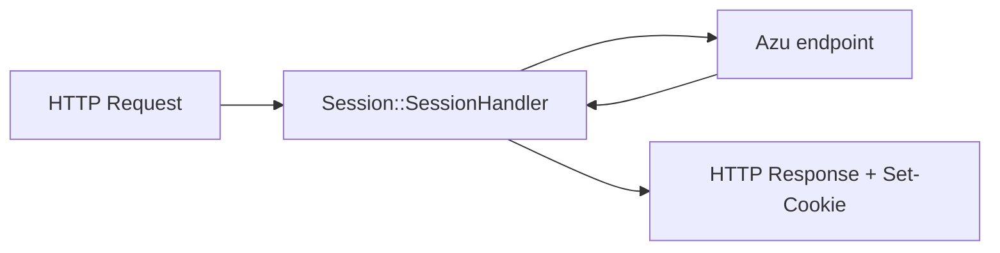

# Azu Integration

`require "session/azu"` is the opt-in integration with the [Azu web framework](https://github.com/azutoolkit/azu), or any `HTTP::Server` application. It needs no dependency on Azu: it adds a typed `session` and `flash` to `HTTP::Server::Context`, which every Azu endpoint has at hand.



## What you get

| | |
|---|---|
| `Session::SessionHandler` | Loads the session per request, saves it just before the response starts, forgets it afterwards. Concurrent requests never share a session. |
| `Session::Web.use_store(StoreType)` | `Session.use_store` plus the typed accessors below. |
| `context.session` | The request's session, typed as your `Session::Base` subclass. |
| `context.flash` | The request's `Session::Flash`: `flash["notice"] = "Saved"` is shown on the next request, once. |
| `Session.session.authenticate { }` | Change privileges (log in) and get a new session id in one step. |
| Cookie defaults | `HttpOnly`, `Secure`, `SameSite=Strict`; the cookie store signs and encrypts. |

There is no database-backed store. The stores are `CookieStore`, `MemoryStore`, `RedisStore` and `ClusteredRedisStore`.

## Setup

```crystal
require "session/azu"

class UserSession < Session::Base
  property user_id : Int64? = nil

  def authenticated? : Bool
    !user_id.nil?
  end
end

Session::Web.use_store(Session::CookieStore(UserSession))

Session.configure do |config|
  config.secret = ENV["SESSION_SECRET"]
  config.timeout = 8.hours
  config.session_key = "myapp_session"
  config.store = Session::CookieStore(UserSession).new
end
```

`SESSION_SECRET` is required in production and staging (`CRYSTAL_ENV`): the published default secret is refused there, because anyone could forge a cookie signed with it. Generate one with `Random::Secure.hex(32)` and keep it in your process environment.

## Mount the handler

Put the handler before the endpoints, after the handlers that must see every request (request id, logging, error rescue):

<!-- skip -->
```crystal
MyApp.start [
  Azu::Handler::RequestId.new,
  Session::SessionHandler(UserSession).new(Session.session),
  # ... your other handlers
]
```

## Use it in endpoints

<!-- skip -->
```crystal
struct Sessions::CreateEndpoint
  include Azu::Endpoint(Sessions::CreateRequest, Azu::Response::Empty)

  post "/login"

  def call : Azu::Response::Empty
    unless user = User.authenticate(create_request.email, create_request.password)
      context.flash["error"] = "Invalid email or password"
      return redirect to: "/login", status: 303
    end

    # A new session id on every privilege change: a planted id is worthless (session fixation)
    Session.session.authenticate { |session| session.user_id = user.id }
    context.flash["notice"] = "Welcome back"
    redirect to: "/account", status: 303
  end
end

struct Sessions::DestroyEndpoint
  include Azu::Endpoint(Sessions::DestroyRequest, Azu::Response::Empty)

  delete "/logout"

  def call : Azu::Response::Empty
    Session.session.delete
    redirect to: "/login", status: 303
  end
end
```

`context.session.user_id` reads the session inside any endpoint. Without `session/azu`, `Session.session.current_session` and `Session.session.flash` are the same objects.

## Flash messages

`flash["notice"] = "..."` stores the message for the next request. That request reads it with `context.flash.now["notice"]?`; the request after it no longer sees it. `flash.keep("notice")` carries it over once more, `flash.to_h` returns what a view shows.

Pass them to your page explicitly:

<!-- skip -->
```crystal
HomePage.new(messages: context.flash.to_h)
```

## Cookies

```crystal
Session.configure do |config|
  config.cookie_secure = true                              # default; false only for plain http that is not localhost
  config.cookie_same_site = HTTP::Cookie::SameSite::Strict # default; Lax if you sign in from links in other sites
end
```

Browsers keep a `Secure` cookie over plain http on `localhost`, so development needs no change.

Choose the store by how you must revoke sessions. The cookie store keeps the session in the browser: signing out clears the cookie, but a copy of it stays valid until it expires, and `authenticate` cannot invalidate the old copy. Use `RedisStore` (or the memory store on a single server) when a session must be revocable.

## Things to know

- The current session is kept per fiber. A fiber you `spawn` during a request starts with a blank one: read what you need before spawning.
- The session is saved just before the first byte of the response is written. Changes made after that (while streaming) are not saved.
- Static files that pass through the handler also rotate the flash. Mount the static handler before the session handler.
- Azu's own `Azu::Helpers::Context#session` and `#flash` read unsigned `_session` and `_flash` cookies, not this shard's: pass the values to your templates as shown above.

## Testing

The shard's own specs run a real `HTTP::Server` on an unused port and drive it with `HTTP::Client` and a cookie jar (`spec/web_spec.cr`): login, flash shown once, id regeneration, tampered cookies and concurrent visitors. The same approach works for your application.

<!-- skip -->
```crystal
server = HTTP::Server.new([Session::SessionHandler.new(Session.session), app_handler] of HTTP::Handler)
address = server.bind_unused_port
spawn { server.listen }

cookies = HTTP::Cookies.new
headers = HTTP::Headers.new
cookies.add_request_headers(headers)
response = HTTP::Client.get("http://#{address}/login", headers)
cookies.fill_from_server_headers(response.headers)
```
